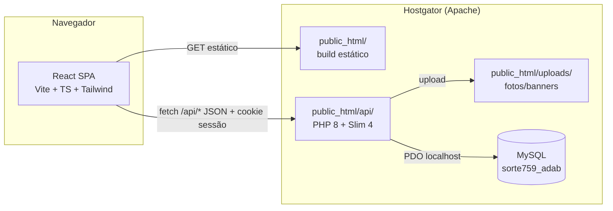

# 03 — Arquitetura

## Visão geral



Mesma origem: `adab.teo.br` serve o site/painel (SPA) e `adab.teo.br/api`
expõe a API PHP — sem CORS, cookies de sessão funcionam nativamente.

## Decisões-chave

| Decisão | Motivo |
|---------|--------|
| SPA React + API PHP Slim na mesma hospedagem | Única stack suportada pelo plano; um deploy só |
| Autorização na camada de API (middleware de perfil) | MySQL compartilhado não tem RLS — ver doc 05 |
| Sessão PHP com cookie httpOnly | Mais simples e segura que JWT para mesmo-origem |
| Build do front + `composer install` no CI; deploy via FTPS | Servidor não tem Node nem Composer |
| `uploads/` fora do git e excluído do sync do deploy | Arquivos enviados em produção não podem ser apagados |

## Estrutura de pastas proposta

```
adab/
├── src/                   # frontend React
│   ├── app/               # rotas públicas (site)
│   ├── admin/             # painel restrito
│   │   ├── membros/  cultos/  eventos/  acoes/  ebd/
│   ├── components/  lib/  hooks/  types/  schemas/
│   └── main.tsx
├── api/                   # backend PHP (deploy p/ public_html/api)
│   ├── index.php          # front controller (Slim) — único arquivo acessível
│   ├── .htaccess          # nega acesso a tudo exceto index.php
│   ├── src/               # Controllers, Middleware, Migrator, Database, Json
│   ├── migrations/        # *.sql versionados
│   ├── tests/             # PHPUnit
│   ├── config.example.php # template (sem segredos)
│   ├── migrate.php        # CLI: aplica migrations
│   ├── create-user.php    # CLI: cria usuário do painel
│   └── composer.json
├── dev/docs/              # esta documentação
├── .devin/                # configuração Devin CLI
├── .github/workflows/     # ci.yml + deploy.yml
└── tests/                 # e2e (Playwright)
```

No servidor (via FTP):

```
public_html/
├── index.html  assets/  uploads/      # build do front + uploads
└── api/
    ├── index.php  .htaccess  vendor/
    └── config.php                    # gerado pelo deploy (secrets)
```

## Fluxo de dados

1. Login → `POST /api/auth/login` → sessão PHP + cookie `httpOnly,
   SameSite=Lax` (CSRF token para mutações).
2. Middleware de perfil lê `$_SESSION['perfil']` e autoriza a rota;
   escopo de dados (ex.: professor → própria classe) aplicado nas queries.
3. Front usa TanStack Query sobre `fetch('/api/...')`; formulários com
   react-hook-form + zod.
4. Uploads → `api` grava em `uploads/` e salva URL relativa no MySQL.
5. `.htaccess` na raiz: SPA fallback (`/admin/*` → `index.html`) e
   bypass de `/api` para o front controller.

## Estados

- Estado de servidor: **TanStack Query**.
- Estado local de UI: `useState`/context — sem Redux.
