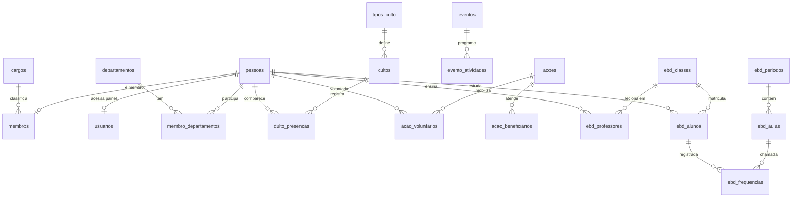

# 04 — Modelo de Dados

Banco: **MySQL** (`sorte759_adab`, utf8mb4, InnoDB) na Hostgator.
Convenções: snake_case, `id BIGINT UNSIGNED AUTO_INCREMENT PRIMARY KEY`,
timestamps `DATETIME`, soft delete via `deleted_at`, auditoria
`created_by/created_at/updated_at`, booleanos `TINYINT(1)`,
valores monetários `DECIMAL(10,2)`.

## Diagrama ER

## Núcleo

### `pessoas`
Base de qualquer indivíduo (membro ou não — aluno da EBD, beneficiário,
visitante). Separar pessoa de membro permite cadastrar aluno da EBD que
ainda não é membro.

| Coluna | Tipo | Observação |
|--------|------|------------|
| nome_completo | varchar(200) not null | FULLTEXT p/ busca |
| nome_social | varchar(200) | |
| data_nascimento | date | |
| sexo | char(1) | 'M'/'F' |
| estado_civil | varchar(20) | solteiro/casado/viúvo/divorciado |
| conjuge_id | bigint fk pessoas | opcional |
| cpf | varchar(14) | opcional, unique quando preenchido |
| telefone, email | varchar(120) | |
| cep, logradouro, numero, complemento, bairro, cidade, uf | varchar | |
| foto_url | varchar(255) | `uploads/membros/...` |
| consentimento_lgpd_em | datetime | data do aceite (doc 05) |
| observacoes | text | |

### `membros` (1:1 com pessoas)
| Coluna | Tipo | Observação |
|--------|------|------------|
| pessoa_id | bigint pk fk pessoas | |
| numero_carteirinha | varchar(30) unique | |
| data_conversao, data_batismo | date | |
| batizado_espirito_santo | tinyint(1) | |
| congregacao | varchar(120) | sede ou nome da congregação |
| procedencia | varchar(200) | igreja de origem |
| cargo_id | bigint fk cargos | |
| status | enum | ativo/afastado/transferido/falecido/disciplinado |
| data_status | date | quando o status mudou |

### `cargos` / `departamentos` / `membro_departamentos`
- `cargos`: membro, congregado, auxiliar, diácono, presbítero,
  evangelista, missionária, pastor (campo `ordem` para hierarquia).
- `departamentos`: nome, descrição, `lider_id fk pessoas`, `ativo`.
- `membro_departamentos`: N:N com `funcao`, `data_inicio`, `data_fim`.

### `usuarios`
| Coluna | Tipo | Observação |
|--------|------|------------|
| pessoa_id | bigint fk pessoas | |
| email | varchar(120) unique not null | login |
| senha_hash | varchar(255) | `password_hash()` |
| perfil | enum | admin/secretaria/dirigente/ebd_admin/ebd_professor/lider_departamento |
| ativo | tinyint(1) | |
| ultimo_login_em | datetime | |

## Cultos

- `tipos_culto`: nome, dia_semana_sugerido, horario_padrao, ativo
- `cultos`: tipo_culto_id, data, horario_inicio, dirigente_id fk pessoas,
  pregador_id fk pessoas, tema, total_presentes, total_visitantes,
  total_decisoes, observacoes. Unique (tipo_culto_id, data).
- `culto_presencas`: culto_id + pessoa_id (presença nominal — opcional,
  MVP pode usar só os totais)

## Festividades e eventos

- `eventos`: nome, tipo, data_inicio, data_fim, local, descricao,
  banner_url, `publico tinyint(1)`, status
- `evento_atividades`: evento_id, data, horario_inicio, horario_fim,
  titulo, responsavel_id fk pessoas, descricao

## Ações

- `acoes`: nome, tipo, data_inicio, data_fim, local, objetivo, resultado,
  departamento_id, status
- `acao_voluntarios`: acao_id + pessoa_id + papel (coordenador/voluntario)
- `acao_beneficiarios`: acao_id, nome, contato, observacao

## EBD

- `ebd_classes`: nome, faixa_etaria, sala, ativo
- `ebd_professores`: classe_id, pessoa_id, papel
  (titular/auxiliar/substituto), data_inicio, data_fim, ativo
- `ebd_alunos`: classe_id, pessoa_id fk pessoas, data_matricula,
  data_desistencia, status (matriculado/transferido/desistente),
  observacao — um aluno só tem uma matrícula ativa por classe
- `ebd_periodos`: ano, trimestre (1-4), tema_revista, data_inicio, data_fim
- `ebd_aulas`: periodo_id, numero_licao, titulo_licao, data,
  texto_aureo, leitura_biblica
- `ebd_frequencias`: aula_id, aluno_id, presente, trouxe_biblia,
  trouxe_revista, oferta decimal(10,2), visitante.
  Unique key (aula_id, aluno_id). Campos extras reproduzem a chamada
  clássica da EBD.

## Índices

- `pessoas`: FULLTEXT em `nome_completo` (ou `LIKE 'termo%'`)
- `cultos(data)`, `eventos(data_inicio)`, `ebd_aulas(data)`
- Soft delete: filtro `deleted_at is null` nas queries; índices parciais
  não existem no MySQL — usar índice composto (ex.: `(deleted_at, nome)`)

## Views

- `v_membros_ativos`: pessoas + membros com status 'ativo'
- `v_programacao_publica`: cultos + eventos `publico` futuros (site)
- `v_ebd_frequencia_resumo`: frequência agregada por classe/período
- `v_aniversariantes_mes`: membros ativos por mês de aniversário
